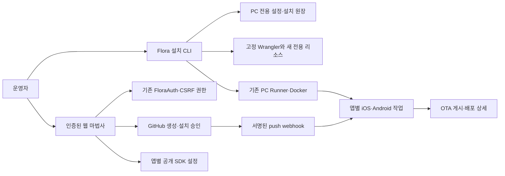

# Flora 설치 마법사 상세 설계

작성일: 2026-10-18 · 상태: 사용자 검토 대기 · 기준 소스: `6752b3f21908af22a772ec913736a7c998e2a480`

이 문서는 승인된 **로컬 설치 CLI + 웹 마법사** 접근을 구체화한다. 구현·원격 리소스 생성·실제 배포 검증은 아직 수행하지 않았다. 사용자는 상세 설계 작성을 승인했으며, 이 문서의 승인 다음 단계는 구현 계획 작성이다.

## 1. 사용자 목표와 완료 기준

처음 쓰는 사람이 README의 설치 명령에서 시작해, 수동 Wrangler JSON 편집·승인 코드 digest 계산·브라우저 개발자 도구 없이 소유자 등록, GitHub 연결, 앱별 SDK 공개 설정, PC Runner 등록, 첫 OTA 게시를 완료하도록 한다. EAS와 GitHub Actions는 사용하지 않는다.

새 전용 설치와 기존 설치를 처음부터 구분한다. 새 설치는 이 마법사가 생성하고 기록한 리소스만 구성한다. 기존 설치는 정상 로그인 후 이미 있는 연결·키·Runner·이력을 확인해 이어간다. 기본 관리자 비밀번호를 만들거나 기존 계정을 초기화하지 않는다.

첫 OTA 완료는 선택한 앱·커밋·채널·runtime의 **선택한 모든 플랫폼**에 대응하는 성공 작업과 실제 게시 배포가 모두 있을 때다. iOS + Android를 선택했는데 하나만 게시되면 부분 완료다. OTA 게시, 자산 다운로드 검증, 기기의 적용·재시작은 각각 별도 결과로 표시한다.

## 2. 선택한 방식과 범위

| 방식 | 평가 |
| --- | --- |
| 로컬 CLI + 인증된 웹 마법사 | 선택. 운영자 권한과 PC 파일 작업은 로컬에서 처리하고 GitHub 승인·앱 관리는 기존 웹 인증 경계 안에서 수행한다. |
| 웹 안내만 추가 | 최초 승인 코드 발급과 PC private JSON 작성이 남아 목표를 충족하지 못한다. |
| 브라우저와 localhost를 직접 연결하는 설치 에이전트 | 별도 pairing·CORS·포트/Host 검증·로컬 권한 경계가 생긴다. 첫 버전에 포함하지 않는다. |

첫 버전에는 새 서버 구성, 최초 1회 승인 코드 발급, 기존 설치 연결, GitHub 연결·프로젝트 선택, 공개 SDK 파일 생성, PC Runner 설정 생성·실행 확인, 첫 자동 OTA 안내와 증거 확인을 포함한다.

기존 인증 DB 복원, setup 재발급·비밀번호 복구 자동화, 기존 DB/Worker 인수, 서비스 키 교체, 임의 저장소를 지원하는 GitHub Release 자산 저장소, 자동 스토어 서명/제출, 범용 재부팅 서비스 설치는 포함하지 않는다. 기존 운영 서비스는 그대로 둔다. 첫 바이너리 빌드·설치는 해당 앱의 Xcode/Gradle 절차로 안내한다.

## 3. 현재 구현과 바꾸는 지점

| 현재 근거 | 설계에서의 사용 |
| --- | --- |
| `packages/cli/src/main.ts` | 기존 doctor와 CLI 진입점을 유지하고 `setup` 명령군을 분리된 모듈로 추가한다. |
| `packages/cloudflare/public/auth.js`, `src/auth-state.ts` | 현재의 typed `FLORA_SETUP`, 10분 창, 단회 사용, epoch·세션 취소 규칙과 등록 API를 유지한다. |
| `public/admin-routes.js`, `public/app.js` | 인증된 `/onboarding` 경로와 단계별 UI를 추가한다. 기존 화면은 계속 직접 접근할 수 있다. |
| `src/managed-connections.ts` | GitHub manifest·설치·저장소 조회와 앱별 기존 서명 키 재사용을 유지한다. |
| `src/http.ts`, `src/worker.ts` | 새 문서 경로와 모듈 자산만 명시적으로 허용한다. 일반 URL fallback이나 공개 운영 API는 만들지 않는다. |
| `packages/dashboard/src/automation-http.ts` | 현재 Runner 등록/취소·앱별 automation API를 사용한다. 새 토큰 전달 프로토콜을 도입하지 않는다. |
| `packages/ota-runner/src/config.ts`, `scripts/local-runner/supervisor.mjs` | 생성한 설정을 실제 validator로 검증하고 기존 foreground supervisor를 실행한다. |

현재 `/api/auth/options`는 비밀번호 정책만 알려준다. D1 marker나 `/setup` 접근 성공으로 최초 발급 여부·등록 성공·토큰 소비 여부를 판단할 수 없다. 마법사는 이를 추정하는 공개 API를 추가하지 않는다.

현재 Runner 등록 POST는 매번 새 Runner를 생성하며 토큰은 한 번만 반환한다. 마법사는 응답 유실을 자동 재요청으로 처리하지 않는다. 현재 체크리스트의 한 플랫폼 성공 조건은 모든 선택 플랫폼과 배포를 대조하는 조건으로 보강한다.

## 4. 구조와 책임

CLI는 Cloudflare 운영자 인증을 Wrangler에 맡긴다. 계정 인증 토큰·쿠키를 복사하거나 웹 서버에 전달하지 않는다. 웹은 기존 소유자 세션·CSRF·권한 검사를 사용한다. 비밀번호는 본인 HTTPS 등록 화면에서만 입력하며 CLI가 수집하지 않는다.

브라우저에서 PC로 전달하는 비밀은 기존 화면이 한 번 표시하는 앱 전용 Runner 토큰 하나다. CLI의 echo 없는 입력으로 받는다. 명령 인자·환경변수·URL·localStorage·로그로 전달하지 않는다. 브라우저는 로컬 파일 시스템이나 Docker socket에 접근하지 않는다.

## 5. 사용 흐름과 화면

### 5.1 CLI 진입

설치·build 후 `npm exec --yes --package=pnpm@11.19.0 -- pnpm flora setup`을 실행한다. Node·Git·고정 도구를 먼저 확인하고 다음 시작점을 제시한다.

- **새 Flora 서버 만들기:** 계정·사용하지 않는 Worker 이름·새 전용 D1 이름·본인 HTTPS hostname·소유자 이메일을 입력한다.
- **기존 Flora에 연결:** 정확한 HTTPS origin을 확인하고 브라우저의 기존 로그인과 웹 마법사로 이어간다. 기존 인프라 설정 파일·DB를 수정하지 않는다.
- **이 PC를 Runner로 연결:** 이미 등록한 앱을 위한 PC 설정 단계로 간다.

`flora setup --resume /절대/private/설치원장.json`은 같은 설치를 재개한다. `flora setup inspect --state /절대/private/설치원장.json --json`은 비밀 없는 로컬 진단만 출력하며 원격 변경을 하지 않는다. `flora setup runner`는 PC 설정만 실행한다. 지원 인자는 이 명령군으로 제한하고 토큰·비밀번호·임의 shell 명령을 받는 플래그는 만들지 않는다.

처음 선택할 때 만들 리소스와 hostname을 요약해 보여준다. DB/Worker의 최종 이름에는 기록한 설치 ID에서 만든 고유 접미사를 포함하고 실제 이름을 확정 전에 보여준다. 설치 중 이 새 전용 자원은 다른 배포 도구가 수정하지 않는 단일 작성자 조건으로 사용한다. 유료 전환·R2 구독·결제·GitHub Actions·EAS 설정은 생성하지 않는다. 계정의 남은 무료 리소스/한도를 확인할 수 없거나 기존 이름·hostname이 사용 중이면 명확한 원인과 재확인 동작을 표시하고 변경을 중단한다. 무료 범위를 자동 확장하지 않는다.

### 5.2 새 서버와 최초 관리자

1. 새 private 경로·설치 ID·계정·선택 이름·계획을 기록한다. 기존 경로를 덮어쓰지 않는다.
2. 선택한 계정에서 이름 충돌을 확인하고 새 전용 D1을 만든다. 응답의 실제 UUID를 원장에 기록한다.
3. 설치 전용 Worker 설정을 생성한다. 기존 example의 topology·SQLite DO·비공개 routing 기본값은 유지하고 artifact·migration 경로를 절대 경로로 만든다.
4. build·설정 검증·dry-run 후 새 DB의 migration을 적용하고 immutable identity marker를 확인한다. row가 없을 때만 해당 설치의 marker를 넣는다. 불일치는 중단하며 UPDATE/REPLACE/삭제로 맞추지 않는다.
5. 잠긴 Worker를 배포하고 선택한 HTTPS hostname을 연결한다. 실제 계정·Worker·D1 ID·route·배포 receipt와 설정 fingerprint를 확인한다. DNS/TLS와 GET 기반 로그인/비인가 API 동작을 확인한다.
6. **이 마법사의 새 설치에서 최초 발급 기록이 없을 때만** 32바이트 난수, decoded-byte SHA-256, 정확한 600,000ms TTL, generation 1, purpose `enroll`을 준비한다. 원문은 전용 0600 파일, 발급 메타데이터는 복원 대상 DB 밖의 private 원장에 먼저 내구성 있게 저장한다. 그다음 typed `FLORA_SETUP`을 배포한다.
7. HTTPS `/setup`을 열고 소유자가 코드·이메일·새 비밀번호·확인을 제출한다. 코드 확인용 전용 private 파일 위치를 안내하며, 사용자가 로컬 편집기로 코드를 확인한다. digest 계산이나 JSON 편집은 요구하지 않는다. 코드를 URL·stdout/stderr·브라우저 저장소로 보내지 않는다.
8. 웹의 실제 최초 enroll 성공 후에는 고정된 내부 경로 `/onboarding`으로 이동한다. `/setup?returnTo=...`를 허용하지 않으며 복구 성공 후 이동은 기존 동작을 유지한다. 기존 로그인에서는 확장된 admin 경로 allowlist의 `/login?returnTo=%2Fonboarding`을 사용할 수 있다. CLI에서는 로그인 확인을 명시적으로 받으면 `vars.FLORA_SETUP`만 제거해 배포한다. 이 수동 확인은 로컬 원장에 `operator-confirmed`로 기록하며 서버 인증 증거로 승격하지 않는다. 웹의 등록 완료 표시는 유효한 현재 세션에서만 나온다.

승인 창 추가·제거를 포함한 설정 쓰기 직전에 실제 계정·Worker/D1/DO ID와 마지막 확인 배포/설정 fingerprint를 다시 대조한다. 예상 밖 변경이 있으면 중단한다. 독립적으로 수정된 Worker에 이전 전체 설정을 업로드하지 않고 관련 없는 현재 필드를 보존한다. provider가 원격 compare-and-swap이나 여러 자원의 원자적 transaction을 제공한다고 가정하지 않는다. 이 마법사가 만든 자원이라는 receipt와 현재 상태를 확인할 수 없으면 자동 변경하지 않는다. 변경 완료 뒤에도 실제 배포 fingerprint와 원장을 대조하고 불일치는 `확인 필요`로 남기며 자동 rollback하지 않는다. 독립적인 동시 배포 writer와의 무중단 병합은 첫 버전의 지원 범위가 아니다.

등록 창을 여는 시점은 서버·DNS 준비가 끝난 뒤다. 이미 발급됐거나 만료됐거나 발급/배포 결과가 불명확하면 generation 1을 다시 생성하지 않는다. 먼저 기존 로그인 확인과 해당 설치의 발급 원장 확인을 안내한다. 최초 발급 실패를 비밀번호 복구나 리소스 교체로 자동 우회하지 않는다. 최초 발급의 원문을 잃었거나 외부 원장을 잃었을 때 안전한 자동 재발급을 지원한다고 표시하지 않는다.

### 5.3 웹 공통 레이아웃

기존 header·sidebar·footer 안에 전용 설치 페이지를 둔다. 제목은 **Flora 시작하기**, 단계 목록은 왼쪽/상단, 현재 단계의 설명·입력·주 동작은 본문에 둔다. 좁은 화면에서는 한 열로 배치한다. 긴 ID는 기본 설명 대신 기술 상세의 펼치기에 둔다.

단계는 **관리자 → GitHub → 앱·SDK → PC Runner → 첫 OTA**다. 각 단계는 완료 근거, 진행할 동작 하나, 오류 원인·다시 확인 버튼, 관련 기존 관리 화면 링크를 제공한다. 상태는 `준비 필요 / 진행 중 / 사용자 승인 대기 / 확인 필요 / 확인됨 / 실패`로 구분한다. 색 외에도 텍스트로 상태를 표시하고 키보드·초점 이동·live status를 지원한다.

현재 앱 ID와 보고 있는 단계 정도만 편의 상태로 유지한다. 완료 체크값·비밀·세션은 저장하지 않는다. 새로고침과 재로그인 때 실제 API 상태를 다시 읽고 재개한다. 로그인된 기존 사용자를 강제로 마법사에 가두지 않으며 프로젝트 목록과 설정에 시작하기 링크를 제공한다.

### 5.4 GitHub 연결과 앱 등록

기존 GitHub 연결을 먼저 조회한다. 연결돼 있으면 기존 App·설치 범위를 표시하고 재생성하지 않는다. 새 연결은 기존 manifest → GitHub 본인 인증·App 생성 → 같은 origin 콜백의 완료 버튼 → 저장소 설치 승인 흐름을 사용한다. Strict cookie와 세션/epoch에 묶인 state 검사를 유지한다.

콜백에서는 연결 완료 후 설치 마법사로 돌아가는 명시적 동작을 제공한다. 시작할 때 같은 origin의 sessionStorage에 비밀 없는 시작 페이지 힌트 `onboarding`만 남긴다. 완료 handler는 힌트가 정확히 이 값이면 고정 `/onboarding`, 없으면 기존 `/projects/new`로 이동하고 힌트를 제거한다. 힌트는 권한이나 연결 성공 증거가 아니며 돌아온 페이지에서 현재 상태를 다시 확인한다. GitHub의 `code`·`state`나 임의 return URL은 힌트에 저장하지 않는다. 계정 로그인과 저장소 권한 부여를 별도 단계로 설명하고 설치 후 승인된 저장소를 다시 조회해 확인한다.

manifest 변환은 기존 구현이 state를 외부 교환 전에 소비한다. 응답 유실 시 `/api/github/connection`을 다시 읽어 이미 구성된 연결은 재사용한다. 구성되지 않았다고 외부 App 생성·교환도 없었다고 판단하지 않는다. 이 경우 `확인 필요`로 남기고 code 재전송·새 manifest 시작·고아 App 삭제를 자동 수행하지 않는다.

저장소·ref·앱 root를 선택하고 프로젝트를 등록한다. 동일 repository/root가 이미 있으면 기존 앱으로 이어가는 선택을 제공한다. 기존 프로젝트 연결을 몰래 변경하거나 새 이름으로 중복 등록하지 않는다. 저장소 접근 거절·조직 승인 대기·root/config 오류를 구분한다.

### 5.5 앱별 공개 SDK 설정

현재 앱의 서명 준비 API를 사용해 기존 키를 재사용한다. 응답의 앱 ID·인증서·`keyId`를 모두 검증해 **`flora.connection.json` 다운로드**를 제공한다. 다운로드에는 공개 설정만 들어가며 개인키나 Runner 토큰은 포함하지 않는다. 개발자 도구는 필요 없다.

`flora.config.json`이 아직 없으면 현재 GitHub 탐지는 완전한 export 설정을 제공하지 못한다. 따라서 웹에 bundler·entry·Node·package manager·runtime·플랫폼 입력을 명시적으로 둔다. bare RN용 기본 preset은 Metro/index.js, Node 24.19.0/npm 10.9.8이며 사용자에게 앱의 실제 entry·root lockfile과 대조해 확인하도록 한다. pnpm 경로의 정확한 버전과 workspace 조건도 따로 확인한다. 이 값들은 **사용자 선언**으로 표시하고 `parseFloraConfig`의 schema 검증만으로 소스 검증이 끝났다고 하지 않는다. 이미 인식된 config가 있으면 그 값을 재사용하며 잠긴 기존 설정을 자동 교체하지 않는다. 아직 설정 파일이 있어야 나오는 detection을 최초 생성의 필수 입력으로 삼지 않는다.

파일 생성과 Git 커밋에서 실제 인식된 상태를 구분한다. 사용자가 앱 저장소에 공개 파일·SDK tarball·manifest/lockfile·native 연결을 검토해 커밋한다. 원격 소스 동기화 후 해당 ref/SHA의 설정이 생성한 앱·URL·채널·runtime과 일치해야 SDK 단계가 확인된다. 앱의 기존 파일을 자동 덮어쓰거나 package manager를 바꾸지 않는다.

지원 기반은 현재 소스의 RN 0.86.3, 선택적인 Expo 57 adapter다. 앱의 지원 여부·dependency 준비 조건은 실제 parser/검사 결과로 판단한다. 첫 Release 바이너리에 native engine·공개 설정을 포함해야 하며, OTA JS만으로 엔진을 설치할 수 없음을 안내한다. 바이너리 설치 여부는 사용자 확인과 실제 기기 증거를 구분하고 게시 성공으로 추정하지 않는다.

### 5.6 PC Runner 등록과 실행

웹은 현재 앱에만 묶인 Runner를 등록하고 토큰을 한 번 표시한다. 등록 응답과 현재 앱의 automation 목록에서 동일 runner ID·미폐기·단일 app scope를 확인한 뒤에만 **Runner 연결 정보** 다운로드를 제공한다. 이 파일은 정확한 origin·app ID·예상 runner ID만 포함한 공개 JSON이며 서명된 권한증명으로 취급하지 않는다. CLI는 사용자가 선택한 공개 연결 정보와 로컬 SDK 공개 설정의 origin/app ID를 대조하고, 별도 입력한 토큰의 prefix가 예상 runner ID와 일치하는지 검사한다. 원문 토큰은 다운로드 파일에 넣지 않는다. 토큰 입력은 echo를 끄며 EOF·취소·비 TTY에서는 비밀 입력을 거절하고 값을 남기지 않는다.

CLI는 비 root macOS/Linux, Docker daemon·실제 Unix socket·최소 여유 공간, 신뢰하는 immutable image ID/digest, 고정 Node/package-manager 버전, 앱의 dependency 준비 경로를 확인한다. 새 private 디렉터리에 앱별 `runner.json`, `service.json`, scratch·work·recovery 경로를 생성하고 기존 validator로 검사한다. 이미지 준비가 필요하면 고정된 공개 Dockerfile build의 대상·도구 버전을 보여주고 실행한다. 사용자 입력 shell 코드는 실행하지 않는다.

Flora 개발용 pnpm 11.19.0과 현재 pnpm 앱 export용 11.10.0은 별도로 검증한다. 생성한 프로필의 내부 이름을 사용자에게 GitHub Actions 연결로 안내하지 않는다. 지원하지 않는 앱 구성은 lockfile 변경이나 host exporter 우회 없이 중단한다.

설정 후 일회 presence를 전송해 반환 runner ID도 예상 ID와 대조한다. presence 응답 자체는 app scope 증거가 아니므로, 웹은 현재 앱의 automation 응답에서 그 정확한 Runner가 미폐기이고 해당 앱 하나에만 속하는지 확인한다. 이 바인딩과 토큰 prefix가 맞지 않으면 **첫 claim 전에** 거절한다. 이어서 **지금 Runner 시작** 동작으로 그 설정의 foreground supervisor를 실행한다. 현재 세션에서 명시적으로 요청한 프로세스만 관리하고 기존 Runner/VM·LaunchAgent를 종료·교체하지 않는다. 웹은 서버의 fresh presence로 온라인을 확인한다. 등록 receipt나 로컬 파일 생성만으로 온라인 표시를 하지 않는다.

재실행은 같은 private 설정 경로를 재사용하며 신규 토큰을 요구하지 않는다. 별도 0600 `runner-binding.json`에 비밀 없는 origin/app/runner ID와 공개 연결 정보·설정의 fingerprint를 기록하고 CLI 재실행 때 토큰 prefix·presence를 다시 대조한다. 엄격한 기존 `runner.json` schema에 추가 binding 필드를 끼워 넣지 않는다. 기존 설정이 다르면 비교 결과를 보여주고 새 경로를 선택한다. 키·토큰·fatal-stop marker·복구 journal을 정리하는 동작은 제공하지 않는다. 기존 UULab 전용 재부팅 서비스 installer는 이 일반 흐름에서 실행하지 않는다.

### 5.7 첫 OTA 게시와 다운로드

현재 앱·검증 ref·채널·runtime·지원 플랫폼으로 자동 정책을 확인하고 사용자가 명시적으로 저장한다. 기존 활성 정책은 읽어 비교하며 동의 없이 바꾸지 않는다. 첫 확인용 JS 변경을 커밋·push하도록 안내한다. 워크플로 실행을 피하려면 `[skip ci]`를 사용하고 Actions를 dispatch하지 않는다. 마법사가 앱 저장소를 자동 커밋·push하지 않는다.

commit을 인식한 뒤 해당 commit을 검증 대상으로 고정한다. ref가 나중에 움직여도 현재 검증 대상으로 잡은 SHA를 자동 교체하지 않는다. 각 플랫폼의 작업, deployment ID와 실제 배포 메타데이터를 대조한다. 필요한 조건은 다음과 같다.

- 작업과 배포의 앱 ID·SHA·channel·runtime·platform이 모두 검증 대상과 일치한다.
- 작업은 `succeeded`이고 해당 deployment가 operations 데이터에 존재한다.
- 선택한 모든 플랫폼에서 조건을 만족한다. 실패한 형제 플랫폼을 과거 성공 배포로 보완하지 않는다.

완료 화면은 두 플랫폼 각각의 게시 결과와 배포 상세 링크를 제공한다. 선택적으로 매니페스트와 자산을 다운로드해 실제 byte/hash를 검증하면 **다운로드 확인**으로 표시한다. 네트워크·무결성 오류는 원인을 표시하며 자동 재게시하지 않는다. 기기의 다운로드·적용·재시작은 실제 SDK telemetry가 있을 때만 별도 상태로 표시한다.

## 6. 설치 원장과 안전한 재개

CLI 원장은 checkout·운영 DB·백업 경로 밖의 신규 private 디렉터리에 둔다. 파일은 소유자 UID, regular file, 단일 hard link, 0600, 경로 구성 요소의 symlink 없음과 private 디렉터리 0700을 검사한다. 경로는 canonical absolute path로 고정한다. 기존 파일의 권한을 자동 완화·수정하지 않는다.

원장 `schemaVersion: 1`은 설치 ID, 정확한 origin/owner/DB identity, 계획한 이름, 확인된 provider resource ID, 설정 fingerprint, 단계, 변경 요청의 pending/receipt 상태, 최초 발급 메타데이터를 포함한다. 비밀번호·인증 cookie·GitHub private key·원문 승인 코드·Runner token은 원장에 넣지 않는다. 비밀 파일은 별도 0600 파일로 관리한다.

원장 변경은 동시 실행 lock과 exclusive temp file → 내용 fsync → atomic rename → 디렉터리 동기화를 지원하는 내구성 있는 경로를 사용한다. 필요한 내구성/권한 보장을 제공하지 못하는 파일 시스템에서는 원격 변경 전에 중단한다. 원격 변경 전에 intent를 먼저 저장하고, 결과 검증 후 receipt를 기록한다. 오류 때 자원을 자동 삭제하지 않는다.

| 상태/장애 | 재개 동작 |
| --- | --- |
| 검증된 receipt 존재 | 정확한 ID·계정·fingerprint를 재확인하고 다음 단계로 진행 |
| 생성 응답 유실·ID 미확보 | `확인 필요`. 이름만 보고 기존 리소스를 인수하거나 생성 POST를 재전송하지 않음 |
| 배포 응답 유실 | 원장에 있는 정확한 리소스·배포 digest/receipt의 읽기 대조로만 확인; 불명확하면 중단 |
| 최초 발급 intent 존재 | 원문 재생성·generation 1 재사용 금지; private 기록/배포 상태 확인 |
| 관리자 등록 응답 유실 | 같은 새 비밀번호로 기존 로그인부터 확인; 새 승인 창 자동 발급 금지 |
| GitHub manifest 변환 응답 유실 | 현재 연결을 다시 확인해 구성된 연결만 재사용. 미구성이어도 code 교환/새 App 생성을 자동 재시도하지 않음 |
| Runner 등록 응답 유실 | 앱별 Runner 목록을 확인하고 미확정 상태 유지. 자동 POST 재요청 금지 |
| 토큰을 잃은 고아 Runner | 정확한 Runner를 식별한 뒤 사용자가 명시적으로 폐기하고 새 등록. 다른 Runner는 유지 |
| 원장 유실·identity 변경·이전 인증 DB 복원 | 새 설치로 취급하지 않음. 기존 운영/복구 절차로 연결하고 초기 발급 중단 |
| 무료 quota 초과 | 원인과 provider의 확인 가능한 reset 안내를 표시. 유료 전환·다른 DB로 우회·이력 삭제 없음 |

이 원장은 등록 성공 여부에 대한 서버 권한이 아니다. UI 완료 상태는 서버에서 다시 확인한다. 기존 인증 복구는 최고 발급 generation과 claimed-owner marker를 보존해야 하는 별도 운영 절차다.

## 7. API·조회량·데이터 보존

진행 정보 전용 D1 테이블·개별 설치별 성공 플래그·주기적 저장 작업을 추가하지 않는다. 기존 session, managed GitHub, operations, automation 응답에서 현재 단계의 상태를 도출한다. 인증·CSRF·session/epoch fence와 callback state 소비 규칙을 유지한다.

마법사 진입, 사용자 동작 완료, 외부 승인 후 복귀 때 필요한 데이터만 한 번 읽는다. 같은 route의 operations/automation 데이터를 공유한다. 작업이 queued/leased/cancel_requested일 때만 기존 자동화 조회 스케줄러 하나를 사용하고, terminal·페이지 숨김·이탈·로그아웃 시 중지한다. 대기 중인 GitHub push는 명시적 새로 확인 동작을 기본으로 하며 idle 별도 poller를 만들지 않는다. Runner supervisor의 adaptive idle 간격은 유지한다.

GitHub 저장소 목록은 기존 cursor와 상한으로 읽고, 앱별 이력·기기 목록 전체를 가져와 마법사 상태를 계산하지 않는다. 알려진 작업 ID는 기존 `GET /api/apps/{appId}/automation/jobs/{jobId}`로 읽는다. 배포가 operations의 최근 20개 목록에 있으면 그 데이터를 재사용한다.

배포가 목록 밖에 있을 때만 새 인증 API `GET /api/apps/{appId}/ota/deployments/{deploymentId}/publication`을 한 번 사용한다. 기존 `getOTADeployment(appId, deploymentId)` 계약을 활용해 소유자·identity·app/UUID 검사를 거친 indexed point lookup으로 `{appId, deploymentId, deployment:{id,platform,channel,runtimeVersion,commitSha,createdAt}}`만 반환한다. private asset과 동일한 소유자 세션 권한을 요구하며 다른 앱/없는 배포는 404, session 미인증은 401, identity/메타데이터 충돌은 409, 저장소 장애는 503이다. device 상태·asset bytes·이력 목록·private key는 반환하지 않는다. 새 D1 schema는 필요 없다.

기존 `/telemetry` 상세는 최초 접근 때 rollback 이력을 초기화할 수 있어 이 단순 확인에 사용하지 않는다. 새 publication API는 SDK telemetry 초기화와 독립적이며 이력 스캔·hydration·쓰기 없이 같은 수의 조회를 유지해야 한다. 작업 receipt의 deployment를 검증하지 못하면 완료가 아니라 확인 대기다. 무제한 목록이나 전용 polling API는 만들지 않는다.

기존 연결·서명 키·Runner·설정·이력은 재사용한다. 새 설치는 새 DB에서만 migration을 실행한다. 기존 작업실 경로에서는 bootstrap·identity INSERT·setup 발급을 호출하지 않는다. 키 교체·복구 journal 삭제·기존 자산 저장소 이동은 수행하지 않는다.

## 8. 구현 경계

다음 파일군이 변경 대상이며 이 문서 작성 단계에서는 만들거나 변경하지 않는다.

- `packages/cli/src/setup-command.ts`, `packages/cli/src/setup/`: 프롬프트/입력 검사, private 원장, 고정 provider 명령 adapter, 새 설치·Runner 구성. 주 CLI에는 엄격한 dispatch만 추가한다.
- `packages/cloudflare/public/onboarding.js`, `onboarding.css`, `onboarding.d.mts`: 상태 도출·단계 UI·공개 파일 생성·완료 조건을 분리한다. 기존 거대한 `app.js`에 설치 전체를 넣지 않는다.
- 기존 `index.html`, `admin-routes.js`, `app.js`, auth UI: 전용 route, 공통 shell, 기존 컨트롤러 연결, 최초 enroll 후 경로, 모든 플랫폼 게시 조건을 필요한 만큼 수정한다. 현재 관리 페이지의 직접 접근을 보존한다.
- 기존 `src/http.ts`, `auth-do.ts`, operations 접근 계층, hosted build의 자산 목록·라우팅 테스트: 새 명시적 문서/자산과 최소 publication 조회의 인증 경계를 반영한다. 공개 setup issuer/localhost bridge/test 제어 경로는 추가하지 않는다.
- CLI·웹·Runner 연동 테스트와 한국어/영어 README: 실제 명령과 오류 안내를 반영하고 수동 JSON/DevTools 경로를 주 설치 절차에서 제거한다.

## 9. 검증과 수용 조건

검증은 기능을 대신하는 가상 체크 표시가 아니라 단계별 증거로 기록한다. 기존 통과 기록을 이번 마법사 검증으로 재사용하지 않는다.

| 검증 층 | 필요한 증거 |
| --- | --- |
| CLI 단위/통합 | 비 TTY·취소·비밀 무출력, symlink/hardlink/공유 경로 거절, 파일 권한·내구성·동시 실행, 고정 argv, 계정/이름/identity 불일치 거절, 다른 앱의 Runner 토큰/연결 정보 혼합을 첫 claim 전에 거절 |
| 중단·응답 유실 | 각 원격 변경 전후 crash 재개, 미확정 POST 비재전송, 원장/발급 기록 유실·만료·등록 성공 후 재실행·Runner 고아 처리, GitHub 교환 응답 유실, 설정 쓰기 직전 provider drift 거절 |
| 인증 회귀 | 기존 최초 등록/복구·소비/오래된 generation·만료·CSRF·epoch·GitHub callback 테스트 유지; 공개 issuer와 test route가 bundle에 없음 |
| 웹 흐름 | 최초/기존 설치 분기, GitHub 승인·권한 부족, 공개 파일의 keyId 포함/비밀 제외, 앱 전환·로그아웃·뒤로 가기·재로그인 재개, 키보드·좁은 화면 |
| 완료 판정 | 한 플랫폼 성공·과거 SHA·다른 앱/채널/runtime·존재하지 않는 deployment는 전체 완료가 아님; 두 플랫폼의 실제 연결된 성공만 완료 |
| 조회량 | idle/hidden/terminal 별도 timer·불필요 fetch 없음, 단계별 호출 상한과 기존 스케줄러 하나 사용, history/installation fanout 없음; publication point API는 이력 증가/telemetry 비활성에도 같은 조회 수·무쓰기 유지 |
| 새 clone | 빈 HOME/cache와 독립 config에서 pinned install·build·typecheck·전체 테스트·doctor·setup CLI 시작/취소·공개 SDK 파일/Runner 설정 validator 통과 |
| 실제 첫 OTA | 별도 QA Worker/DB/private 경로와 독립 GitHub 앱 저장소 두 개. 실제 승인·새 commit push → signed webhook → PC Docker export → 두 플랫폼 게시 → manifest/asset 다운로드 hash 확인 |
| 보존 | 원본 dirty worktree/index hash 유지, 기존 서비스·설정 파일 불변, 기존 앱 DB/키/이력에 변경 명령 없음, QA 두 앱 설정·배포·실패 이력 분리 |

실제 QA는 계정의 무료 리소스 범위와 접근 권한을 먼저 확인하고 기존 운영 자원과 구분한다. 새 자원 생성은 설치 마법사의 검토 화면에서 대상이 확정된 뒤 실행한다. provider 인증·MFA·설치 승인 등 사람의 인증이 필요하면 해당 단계에서 사용자에게 인계한다. 미승인·quota·기기 부재를 fixture 성공으로 대체하지 않는다.

검증 기록에는 소스 commit, 환경, 실제 명령의 종료 코드, pass/fail/skip, QA 리소스/작업·배포 ID, platform/SHA/runtime/channel, 공개 자산 hash, 조회량 및 보존 결과를 남긴다. 비밀값·인증 callback code/state·쿠키는 기록하지 않는다. 기기 실행을 하지 않았다면 적용·재시작은 **미검증**으로 남긴다. EAS 호출과 Actions 실행이 없는지도 별도로 확인한다.

## 10. 설계 검토와 다음 단계

이 설계는 새 설치의 최초 1회 발급과 기존 API 조합으로 범위를 제한한다. 자동 재발급·복원·로컬 pairing을 숨겨 추가하지 않는다. 보류된 구현 선택지나 자동 재시도 권한을 남기지 않는다. 구현 계획은 이 경계를 파일별 작업과 검증 순서로 나누되 인증/발급과 PC 파일 처리의 안전 조건을 먼저 확인한다.

사용자가 이 설계서를 승인하면 구현 계획을 작성한다. 구현 계획 검토와 실행 방식 선택 뒤에 제품 코드·의존성·실제 QA 리소스 작업을 시작한다.
