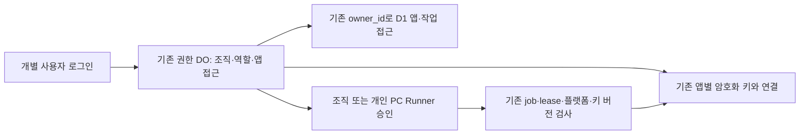

# 조직 계정과 공유 자산 접근 설계

작성일: 2026-10-19 · 검토 갱신: 2026-10-20 KST · 기준 소스: `38459a625facbbe3c7e83f31d7a16da2966e731d`

상태: 사용자가 조직 공유 방향과 **상세 설계 작성**을 승인했다. 이 문서는 첫 구현 범위를 확정하기 위한 검토본이다. 구현 계획 작성·제품 코드 변경·운영 적용 승인을 대신하지 않는다.

검토할 핵심 결정은 다음과 같다. 이번 산출물은 설계 문서이며 운영 계정·키·Runner를 변경하지 않는다.

| 사용자 경험 | 설계 결정 |
| --- | --- |
| 기존 관리자로 계속 사용 | 같은 비밀번호·세션·자산 식별자를 유지한 보호된 조직 Owner |
| 팀원도 자기 계정으로 사용 | Owner가 초대하고 앱 관리자·배포자·조회자와 허용 앱을 지정 |
| 새 PC에서 기존 키 재사용 | 로그인 → 앱 선택 → 별도 Runner 승인·일회 발급 → 필요한 작업의 키만 사용 |
| 퇴사·PC 분실 시 접근 해제 | 팀원·개인 Runner 접근을 회수하고 다른 PC·기존 조직 자동화는 보존 |
| 기존 서비스 유지 | 암호문·키 버전·OTA 신뢰·설정·배포·복구 이력을 다시 쓰지 않는 추가 방식 |

## 1. 목표와 첫 구현 범위

사용자의 목표는 인증서·서명키·푸시키·서비스 연결을 Flora에 한 번 등록하고, 같은 조직의 다른 계정과 승인된 PC가 재업로드 없이 사용하는 것이다. 기존 관리자는 UULab 조직 Owner로 남으며 기존 데이터·키·암호문·앱 설정·배포·접근 이력을 보존한다. EAS·GitHub Actions·신규 유료 서비스를 사용하지 않는다.

첫 구현은 **한 Flora 설치 안의 한 조직, 여러 사용자, 앱별 권한, 기존 자산의 권한 있는 재사용**이다. 새 PC도 기존 Runner 준비 절차와 새 계정 권한으로 연결할 수 있도록 등록·해제 권한을 정의한다. 셀프호스팅 설치마다 독립된 조직을 갖는다. 조직 이름은 기존 workspaceName을 쓰며, UULab 이름을 오픈소스 기본값으로 하드코딩하지 않는다.

다음은 이번 범위에 넣지 않는다: 한 설치의 여러 조직 생성/전환, 서로 다른 Flora 서버 사이의 자산 이전, 조직 Owner 이전, 개인 소셜 로그인/SSO, 이메일 발송 서비스, 제공자 비밀번호 보관, Apple/Google 키 자동 발급·갱신·폐기, 푸시 발송 엔진, 스토어 제출 엔진, 원격 iOS 빌드 서비스. 기존 키 종류의 등록 지원과 이 실행 기능들의 완성 여부는 구분한다.

성공하는 사용자 흐름은 `Owner가 기존 연결 유지 → 팀원 초대·앱 권한 지정 → 팀원이 자기 계정으로 로그인 → 승인받은 앱 운영 → 새 PC에 별도 Runner 등록 → 기존 서버 키를 필요한 작업에 사용`이다. iOS/Android 네이티브 실행은 현재 Runner가 지원하는 OS·도구·소스 준비 조건을 충족해야 한다. 모든 OS에서 모든 빌드가 가능하다고 표시하지 않는다.

## 2. 확인한 현재 구조

| 현재 구성 | 소스 근거 | 설계에 주는 제약 |
| --- | --- | --- |
| 단일 소유자 권한 DO | `worker.ts:45`, `auth-do.ts:70`의 `flora-owner-v1` | DO 이름과 데이터 위치를 유지한다. |
| 소유자 이메일·비밀번호·전역 epoch·브라우저 세션 | `auth-state.ts:33`, `auth-do.ts:273` | 팀원 인증과 Owner 복구를 분리한다. |
| grant에 owner/session/epoch/expiry만 존재 | `contracts.ts:51` | 사용자·멤버십·앱 권한을 추가해야 한다. |
| 앱별 키의 AES-GCM envelope | `credential-vault.ts:64,85` | owner/DB/app/kind/version에 묶인 AAD를 바꾸지 않는다. |
| 네이티브 작업의 제한된 키 전달 | `native-build-store.ts:156` | 앱·플랫폼·job·attempt·키 버전 pin을 유지한다. |
| origin+bearer token 기반 Runner | `ota-runner/src/config.ts:9` | 논리적 PC 등록이며 하드웨어 인증이 아니다. |
| GitHub 연결은 소유자 DO, 앱 연결은 owner/app 범위 | `managed-connections.ts:44`, `operations-store.ts:143` | 제공자 연결은 유지하고 사람의 이용 권한을 추가한다. |

소스 경로는 `packages/cloudflare/src/` 기준이며, Runner 경로만 `packages/` 기준이다. 이 확인은 정적 소스 조사이며 운영 제공자 권한이나 실제 다른 PC 실행의 증거가 아니다.

## 3. 구조 선택

기존 권한 DO 안에 조직·사용자·멤버십 메타데이터를 추가한다. 한 DO가 이 설치의 조직 권한 변경을 직렬화하는 단위다. D1에는 아래의 Runner 신규 발급 cutover gate와 일회용 reservation만 추가한다. 기존 앱·키·작업 행이나 기존 trigger 정의를 수정하지 않는다. 여러 고객의 모든 조직을 하나의 전역 DO에 모으는 SaaS 구조가 아니다.

새 조직 DO로 기존 자산을 옮기는 대안은 암호화 context·epoch·진행 중 lease·복구 저널을 동시에 이전해야 한다. 소유자 계정을 공유하는 대안은 개인별 권한과 이력을 만들 수 없다. 이번에는 기존 저장 권한을 보존하는 추가 방식으로 결정한다.

### 바꾸지 않는 식별자

`FLORA_OWNER_ID`, `FLORA_DB_IDENTITY`, origin, DO 이름, 기존 D1 owner_id/app_id, 키 ID·버전·envelope·AAD, OTA 공개 인증서, Runner credential epoch, 기존 job·attempt·배포 ID를 조직 가입이나 사용자 변경 때문에 바꾸지 않는다. `ownerId`는 저장 권한 식별자로 유지하고 새 `userId`를 그 자리에 넣지 않는다.

`organizationId`와 `userId`는 서버가 생성하고 영속화하는 불투명 ID다. 이메일·조직 표시명·HTTP 헤더로부터 권한 ID를 유도하지 않는다. 조직 행에 기존 ownerId/dbIdentity/origin을 묶고, 불일치 시 새 조직을 자동 생성하지 않고 실패한다.

## 4. 사용자와 권한

기존 관리자 한 명을 보호된 bootstrap Owner로 연결한다. 기존 비밀번호 verifier는 옮기거나 복제하지 않는다. 팀원은 자기 비밀번호와 세션을 가진다. 첫 단계에서 추가 Owner 초대, bootstrap Owner 삭제·강등·이메일 변경은 허용하지 않는다.

팀원 역할은 `admin`, `deployer`, `viewer`이며, Owner를 제외하면 **명시적으로 허용한 앱 목록과 역할의 교집합**만 사용한다. 새 팀원의 앱 목록은 기본적으로 비어 있다. 새 앱이 생겼다고 기존 팀원에게 자동 공개하지 않는다.

| 기능 | Owner | 앱 관리자 admin | 배포자 deployer | 조회자 viewer |
| --- | --- | --- | --- | --- |
| 허용된 앱·상태·OTA·실패/복구 이력 조회 | 전체 앱 | 허용 앱 | 허용 앱 | 허용 앱 |
| OTA 자산 업로드·게시·롤백, export/native 작업 요청·취소 | 가능 | 허용 앱 | 허용 앱 | 불가 |
| 앱 설정·자동 배포/자동 롤백 정책 변경 | 가능 | 허용 앱 | 불가 | 불가 |
| 인증서·키 등록/교체/사용 중지, 앱별 안전한 키 메타데이터 조회 | 가능 | 허용 앱 | 상태·요청에 고정된 버전만 | 상태만 |
| 원문 키·비밀번호·제공자 토큰 다운로드 | 불가 | 불가 | 불가 | 불가 |
| 팀원·초대·역할·앱 접근 관리 | 가능 | 불가 | 불가 | 불가 |
| 앱 생성, GitHub 설치 연결·전체 저장소 검색·저장소 교체 | 가능 | 불가 | 불가 | 불가 |
| 현재 앱의 기존 저장소 인식 갱신 | 가능 | 허용 앱 | 조회만 | 조회만 |
| 현재 허용 앱용 개인 PC Runner 발급/해제 | 가능 | 허용 앱에 대해 승인 | 승인된 PC 등록 요청 | 불가 |
| 공유 조직 Runner 생성/해제 | 가능 | 불가 | 불가 | 불가 |
| 설치·청구 계정 사용량·전체 조직 감사·복구 관리 | 가능 | 불가 | 불가 | 불가 |

admin은 조직 전체 관리자라는 의미가 아니라 허용 앱의 관리자다. deployer의 수동 배포 권한은 새로운 지속 자동화 정책을 만들 권한을 포함하지 않는다. 새 채널·런타임·키 조합은 기존 앱 설정과 모든 기존 검증을 통과해야 한다. 위 권한은 보호된 저장소를 새로 연결하거나 제공자 권한을 넓히지 않는다.

앱 목록·검색·대시보드 합계·Runner 목록·키 메타데이터·타임라인 조상·산출물 링크도 같은 범위로 제한한다. 버튼을 숨기는 것만으로 권한을 적용하지 않는다. 앱 범위 밖과 존재하지 않는 앱은 동일한 404를 반환한다. 허용 앱 안의 금지된 동작은 403이다.

## 5. 추가 저장 모델

다음은 기존 DO SQLite에 추가할 논리 테이블 계약이다. 기존 테이블을 drop/rename하거나 기존 행의 키를 다시 지정하지 않는다. 모든 revision/epoch는 양의 안전 정수, 모든 외래 식별자는 서버 검증값이며 동적 SQL identifier로 사용하지 않는다.

| 테이블 | 주요 내용과 불변식 |
| --- | --- |
| `flora_org_state` | 단일 조직 ID, 기존 저장 owner/DB/origin, schema/protocol 버전, `owner_only / preparing / active / paused` 상태, revision, 개인 PC용 orgAccessEpoch. 식별자 결합은 불변. |
| `flora_org_users` | 불투명 userId, 정규화 로그인 이메일의 unique key, 표시명, `legacy_owner / member` 인증 출처, 상태, authEpoch. bootstrap Owner는 legacy auth만 사용. |
| `flora_org_passwords` | 팀원만의 기존 형식 password verifier. Owner 행은 금지. 원문 비밀번호 없음. |
| `flora_org_memberships` | org/user 결합, 역할, active/disabled 상태, 권한 revision. 보호된 Owner 하나를 유지. |
| `flora_org_app_access` | membership/app 결합과 접근 상태. Owner 외 wildcard 없음. 앱 ID는 기존 canonical owner에 속하는지 확인. |
| `flora_org_sessions` | 팀원의 세션/CSRF 해시, user/membership, authEpoch, 기존 Owner epoch, 만료. 원문 cookie 없음. |
| `flora_org_invites` | nonce 해시, 대상 이메일, invite/reset/reactivate 목적, target user/authEpoch/membership revision·상태, 발급자, Owner epoch·purpose generation, 만료·소비·취소 상태. 원문 nonce 없음. 새 초대/재활성화만 고정 역할·앱 범위를 가짐. |
| `flora_org_runner_access` | 종류+runnerId, org, 고정 앱·플랫폼 범위, `organization / personal` 소유 모드, 발급·승인자, 개인 PC sponsor의 authEpoch/권한 revision과 orgAccessEpoch, ready/revoked 상태. |
| `flora_org_runner_requests` | 요청자·앱·종류·플랫폼, 승인자 권한 snapshot, 요청/승인 만료, pending/approved/issuing/claimed/revoked/unknown 상태와 revision. 토큰 원문 없음. |
| `flora_org_audit` | 순서가 있는 변경 불가 감사 사건과 고정 코드. 사용자/서비스 주체, 앱·작업·Runner·키 버전 참조, operation ID·단계·시각. 비밀 원문 없음. |
| `flora_org_auth_budget` | 팀원별 및 비소유자 합계 로그인/KDF 예산. 기존 Owner 예산과 분리. |

D1에는 `flora_org_runner_gate`(저장 owner별 phase/generation/protocol)와 `flora_org_runner_reservations`(서버 예약 Runner ID, operation, 앱 범위, generation, 미소비/소비 상태)를 추가한다. nonce·token·키는 저장하지 않는다. `automation_runners`의 첫 버전 insert에만 새로운 namespaced guard trigger를 적용한다. gate가 blocked이면 전부 거절하고, ledger_only이면 현재 generation의 정확한 owner/Runner ID/앱 범위 reservation이 있어야 같은 D1 트랜잭션에서 한 번 소비하고 insert할 수 있다. 기존 Runner revoke/version 갱신, lease/job/게시에는 이 신규 발급 guard를 적용하지 않는다. 예약은 Owner가 조작할 수 있는 원문 SQL이나 클라이언트 header로 발급하지 않고 서버의 인가된 enrollment adapter만 만든다.

이 D1 제어 행은 인가 조회 저장소나 전체 ACL 복제본이 아니다. 발급에서만 추가 비용이 들며 세션/프로젝트 조회의 D1 비용을 늘리지 않는다. 행 크기는 최대 2 KiB, 미소비 예약은 동시에 100개 이하, 동일 operation·Runner ID는 unique다. 소비된 예약은 기존 불변 감사 operation에 결합하고, 만료된 미소비 예약의 cleanup은 고정된 최대 50개 페이지로 처리한다. 원본 Runner·키·감사/복구 이력은 cleanup 대상이 아니다.

조직 접근 저장소의 변경은 `transactionSync`에서 권한·expectedRevision·저장 예산 확인과 감사 추가를 함께 수행한다. 관련 쓰기 사이에 await를 넣지 않는다. 외부 API나 D1 요청을 constructor의 schema 초기화 잠금 안에서 실행하지 않는다. 현재 schema 초기화의 transaction 패턴을 따른다.

DO SQL cursor는 다음 await 전에 동기적으로 끝까지 읽어 작은 값 또는 배열로 확정한다. cursor를 await 너머에 보관한 채 권한이나 migration 목록의 일관된 snapshot으로 사용하지 않는다. 읽은 결과가 있어도 후속 부작용 직전의 현재 revision·gate 검사는 생략하지 않는다.

이메일은 새 팀원에 대해 ASCII, 최대 254자, 앞뒤 공백 제거·소문자화로 동일성만 판단한다. Gmail의 점·plus alias 등 제공자별 주소 재작성은 하지 않는다. 기존 Owner 이메일의 로그인 계약은 그대로 보존하며 정규화한 Owner 주소도 초대 대상으로 예약한다. userId는 이메일 재사용으로 다른 사람에게 넘기지 않는다. 첫 단계에서 계정 이메일 변경은 지원하지 않는다.

표시명과 PC label은 1~80자로 제한하고 제어문자를 거절한다. 화면에서는 text로 렌더링하며 HTML·URL·권한 증거로 사용하지 않는다. 클라이언트가 보낸 표시명이나 역할 문자열로 bootstrap Owner를 판정하지 않는다.

## 6. 기존 관리자와 세션 호환

등록된 기존 설치는 Owner verifier·epoch·세션·setup generation을 보존하면서 조직 및 bootstrap Owner의 참조 행을 한 DO 트랜잭션으로 만든다. 기존 로그인 cookie를 강제로 로그아웃시키거나 native Runner의 owner epoch를 증가시키지 않는다.

새 설치는 기존 HTTPS 최초 관리자 등록을 먼저 완료한다. 미등록 상태에서는 팀원 로그인·초대·조직 활성화를 열지 않는다. `setup renew`, 최초 등록, recover의 기존 인증·만료·중복 요청 방지는 변경하지 않는다.

브라우저 cookie 이름·Secure/HttpOnly/SameSite·CSRF 검사는 유지한다. 서버가 기존 Owner 세션 또는 새 팀원 세션의 출처를 결정한다. HTTP의 userId/role/org 헤더나 body를 grant로 받아들이지 않는다. 같은 세션 해시가 양쪽 저장소에서 동시에 확인되는 비정상 상태는 거절한다.

Owner 로그아웃은 기존처럼 해당 세션만 제거한다. 팀원 로그아웃도 해당 팀원 세션 하나만 제거한다. 사용자별 최대 5개 세션과 1시간 만료를 적용하며, 팀원의 여섯 번째 세션이 Owner나 다른 팀원의 세션을 제거하지 않는다.

역할·앱 접근 변경은 해당 사용자의 권한 revision만 증가시킨다. 새 요청은 현재 권한을 다시 읽는다. 진행 중 요청은 await 이후와 민감한 부작용 직전에 revision을 재검사해 중단한다. 단순 권한 변경으로 Owner epoch·기존 공유 Runner를 모두 무효화하지 않는다.

팀원 사용 중지·비밀번호 변경/reset은 해당 user authEpoch와 권한 revision을 증가시키고 팀원 세션을 무효화한다. 개인 PC의 sponsor도 이전 epoch/revision으로 다시 권한을 얻지 못한다. 재활성화는 Owner가 새 reactivate 링크를 명시적으로 발급해야 하며 이전 세션·초대·개인 PC 승인이 되살아나지 않는다.

Owner의 기존 recover는 계속 전역 epoch를 증가시킨다. 새 팀원 세션과 새 개인 PC도 이전 Owner epoch를 허용하지 않는다. 기존 native Runner의 epoch 무효화와 OTA Runner의 독립 credential epoch 동작은 현재 계약을 유지하며, 복구 뒤 재승인이 필요한 대상을 화면에 구분한다.

## 7. 초대·비밀번호 흐름

Owner는 자신의 현재 세션·CSRF 및 최근 5분 내 재인증으로 초대, 멤버 권한 변경, 중지·reset을 수행한다. 기존 Owner의 기존 앱 운영 API에 일괄 재인증 요구를 소급하지 않는다. 재인증은 같은 HTTPS 화면에서 비밀번호를 받아 기존 verifier로 확인하며, 증명은 해당 세션의 서버 상태에만 5분 보관한다.

초대는 이메일 발송 없이 Owner가 복사하여 전달하는 256비트 nonce 링크로 시작한다. 링크는 같은 origin의 `/join#invite=…` 형식이고 nonce를 query/path에 넣지 않는다. 서버에는 해시만 저장한다. 초대 기본 만료는 24시간, reset은 15분이다. 재발급·취소는 이전 nonce를 무효화하고 이력을 남긴다. active 계정에 재초대로 비밀번호를 덮어쓸 수 없다.

가입 페이지는 fragment를 메모리로 읽고 주소 표시에서 제거한다. 제3자 스크립트·분석 요청·localStorage·sessionStorage에 nonce나 비밀번호를 저장하지 않는다. raw nonce는 동일 origin의 제한된 POST body에만 보낸다. 기존 same-origin/CSP/referrer 정책을 적용한다.

미로그인 preview는 유효한 nonce로만 조직 표시명·마스킹한 대상 이메일·역할·허용 앱 수를 반환한다. 앱 이름이나 키·저장소 목록을 공개하지 않는다. nonce만으로 로그인 세션이나 키 접근을 발급하지 않는다.

invite는 존재하지 않는 이메일의 신규 계정만, reset은 현재 active인 사용자·멤버십의 비밀번호만, reactivate는 Owner가 지정한 disabled 사용자·멤버십의 재활성화만 수행한다. 세 목적을 상태에 따라 자동 전환하지 않는다. reset은 역할·앱 접근을 payload나 예전 snapshot에서 복원하지 않으며 수락 시의 현재 접근을 유지한다. reactivate는 새로 승인한 역할·앱 목록을 고정하고 같은 userId를 사용한다.

reset/reactivate는 target userId·정규화 이메일·authEpoch·멤버십 revision/상태·Owner epoch에 묶는다. 기존 사용자 상태가 하나라도 달라지면 nonce는 stale이다. 신규 invite는 target user가 여전히 없음을 확인한다. 비밀번호 변경/reset·사용 중지·역할/앱 접근 변경·재활성화·동일 목적 재발급은 이전 관련 nonce를 revision/generation으로 즉시 무효화한다. 과거 행은 남기고 공개 preview/accept에 상세 무효 사유를 노출하지 않는다.

초대 수락은 `nonce + 초대 대상 이메일 + 새 비밀번호 + 확인`을 받는다. 기존 password verifier/KDF·배포별 최소 길이 정책을 재사용한다. 유효 nonce 확인 후 KDF를 수행하고, 완료 후 동일 nonce·목적·만료·취소·Owner epoch·purpose generation과 target user/authEpoch/멤버십 revision·상태를 최종 트랜잭션 안에서 다시 검사한다. reset/reactivate는 KDF 전에도 같은 snapshot을 확인한다. 사용자·멤버십·앱 접근·세션 생성, nonce 소비, 감사 추가를 한 DO 트랜잭션으로 확정한다. 동시 수락은 한 번만 성공한다.

이 초대는 Owner가 전달한 링크의 소유를 확인하는 방식이며, 독립된 이메일 소유 검증을 했다고 표시하지 않는다. 초대된 사람의 확인과 링크 전달은 Owner가 맡는다. 수락 응답 유실 시 기존 계정으로 로그인하며, 같은 nonce로 비밀번호를 다시 설정하거나 새 계정을 자동 생성하지 않는다. 이메일·토큰·비밀번호는 채팅이나 공개 이슈로 받지 않는다.

미등록 이메일, 사용 중지 계정, 잘못된 비밀번호의 공개 로그인 실패는 같은 401 코드로 처리한다. 초대의 잘못됨·만료·소비·취소도 같은 공개 실패 코드로 묶는다. 공개 이메일 검색·열린 회원가입은 만들지 않는다.

기존 Owner의 15분 5회 요청·시간당 60회 KDF 예산은 유지한다. 새 팀원은 같은 개별 상한과 비소유자 합계 시간당 240회 KDF 상한을 별도로 적용한다. 초대/reset은 유효 nonce 확인 전 KDF를 쓰지 않는다. 팀원·알 수 없는 이메일의 요청이 Owner 예산을 차감하지 않는다. 기존 무대기 heavy-work admission을 유지하여 과부하는 BUSY/Retry-After로 끝내고 비밀번호 자동 재전송 큐를 만들지 않는다.

## 8. 서버 인가 계약

새 내부 grant는 기존 저장 권한에 `organizationId`, `userId`, `membershipId`, 인증 출처, user authEpoch, membership revision, sessionHash/expiry를 연결한다. 세션을 읽은 서버만 만들고 기존 WeakSet 방식의 내부 grant 검증을 유지한다.

인가 입력은 명시적 action과 서버가 파싱한 appId다. `assertCurrent`와 `requireCapability`를 분리하되, D1 제출·암호화 키 사용·제공자 호출 전 fence에는 둘 다 들어간다. body 파싱, crypto, 저장소 읽기, 제공자 응답 등 await 후에는 현재 사용자·멤버십·앱 범위를 다시 검사한다. DO 트랜잭션 안에서도 다시 확인한다.

범위는 다음 entry point 전체를 포함한다: hosted 상태/앱 CRUD/설정/가져오기/로그, OTA 자산/게시/롤백/적용 이력, 자동화 정책/작업/취소, 키 목록/등록/중지, GitHub 설치/저장소/연결, native Runner/작업/키 전달 이력, CI 관리, 사용량, 신규 멤버·감사 API. 분류되지 않은 관리 동작은 Owner에게만 허용하고 팀원에게는 기본 거절한다. 구현 검증은 route 목록과 action 매핑의 빠짐을 검사한다.

Owner-wide 응답을 만든 뒤 브라우저에서 거르는 방식은 쓰지 않는다. 팀원 프로젝트 목록은 DO의 현재 앱 허용 목록을 50개 단위로 읽고 그 ID만 기존 D1 배치 요약에 전달한다. 페이지 중 삭제된 앱 때문에 짧은 결과가 나와도 무한 채움 조회를 하지 않는다. cursor는 org/user/권한 revision/정렬·필터에 묶고, 권한 변경 시 다시 시작한다. 외부 앱의 이름·개수·이력·Runner를 응답에 넣지 않는다.

## 9. 서비스 주체와 지속 자동화

브라우저 멤버와 OTA Runner, native Runner, GitHub webhook, 기존 CI, 자동 롤백은 서로 다른 주체다. webhook/Runner를 가상의 Owner 브라우저 grant로 만들지 않는다. 조직에 귀속시키되 기존 서명·bearer·앱·플랫폼·commit·lease·키 버전 검사를 유지한다.

기존 GitHub push 정책과 자동 롤백은 조직이 승인한 지속 설정이다. 설정을 마지막으로 편집한 팀원이 나가도 임의로 꺼지지 않는다. 정책 변경과 실행 이력에 각각 사람과 서비스 주체를 기록한다. 새 지속 정책 변경은 Owner 또는 허용 앱 admin만 할 수 있다.

권한이 있을 때 서버가 접수한 작업도 조직의 작업으로 남는다. 요청자의 역할 회수만으로 이미 접수된 큐·배포 이력을 소급 삭제하거나 전체 큐를 재생성하지 않는다. 중단하려면 기존 작업 취소를 명시적으로 수행한다. 단, 작업을 실행하는 개인 Runner 자체의 승인이 회수되면 그 Runner의 후속 실행 권한은 끊긴다.

기존 CI 경로를 제거하거나 새로 활성화하지 않는다. CI 관리·binding 변경은 Owner만 수행하고 기존 서비스 인증은 그대로 분리한다. 이번 실행·검증에는 Actions를 사용하지 않는다. public SDK update/asset/report 경로는 기존 공개 또는 SDK grant 정책을 유지하며 조직 브라우저 로그인을 강제하지 않는다.

## 10. PC Runner 등록과 회수

### 조직 PC와 개인 PC

기존에 동작하던 OTA/native Runner는 **legacy 조직 Runner**로 명시적으로 연결한다. 토큰을 재발급하거나 키·저널을 복사하지 않는다. 사용자 로그아웃이나 팀원 권한 변경으로 이 조직 Runner들을 중단시키지 않는다.

새 팀원 PC는 별도 `personal` Runner로 등록한다. 사용자 로그인·앱 선택 후 발급 요청을 만들고 Owner 또는 해당 앱 admin이 승인한다. Owner 외의 self-approval은 허용하지 않으며 admin의 자기 PC는 Owner가 승인한다. 보호된 Owner는 최근 재인증 후 자기 PC를 직접 승인할 수 있다. 등록 앱은 요청자와 승인자의 허용 앱 교집합, 플랫폼·역할은 서버가 허용한 범위로 고정한다.

요청은 최대 24시간 대기할 수 있고 승인은 토큰을 발급하지 않는다. 승인 후 10분 이내 요청자 본인이 현재 로그인·앱 권한으로 claim할 때 기존 enrollment를 호출해 raw Runner token을 한 번 반환한다. 승인자의 현재 권한과 요청자/승인자 권한 revision도 claim 직전에 재확인한다. 변경됐으면 새 승인이 필요하다. 요청 body의 label은 표시 정보일 뿐 기기 인증 증거가 아니다.

기존 CLI는 승인된 앱 binding과 그 PC용 새 토큰으로 private 설정을 준비한다. 인증서·Apple/Google 로그인 비밀번호를 PC에 복사하지 않는다. native와 OTA 토큰은 기존처럼 별개다. 한 PC가 두 실행 모드를 쓰면 각 등록을 같은 PC 표시 그룹에 연결할 수 있지만 권한을 합쳐 하나의 토큰으로 만들지 않는다.

새 bearer는 현재 조직의 개인 PC orgAccessEpoch와 사용자 상태·authEpoch·멤버십 revision, 등록 앱/플랫폼과 기존 credential/lease를 함께 확인한다. 세션 cookie가 만료되거나 웹에서 로그아웃했다는 이유로 자동 시작 서비스를 중단시키지 않는다. 대신 사용 중지·비밀번호 변경/reset·역할/앱 범위 변경은 개인 Runner의 이전 sponsor 승인을 무효화한다. 재승인은 새 Runner 자격 증명으로 하며 이전 토큰이 자동 부활하지 않는다.

개인 Runner를 공유 조직 Runner로 바꾸려면 Owner가 새 조직 Runner를 발급하고 이전 개인 토큰을 명시적으로 회수한다. 기존 토큰의 메타데이터만 바꿔 권한을 확장하지 않는다. 조직 Runner는 사람의 퇴사 처리와 별개로 남으므로 멤버 화면에 이 차이를 표시한다.

이것은 서버상의 개별 Runner 등록이지 PC 하드웨어 증명·토큰 복제 방지·원격 키 삭제의 보장이 아니다. 이미 전달된 키를 서버가 회수할 수 있다고 표시하지 않는다. 향후 키 전달과 요청을 막고 기존 컨트롤러가 임시 키·Keychain을 정리하도록 한다.

### 발급과 회수의 원자성

새 OTA 등록은 권한 범위를 고정한 DO pending 등록에 서버 생성 Runner ID를 먼저 예약하고, 같은 ID·operation·앱 범위·gate generation의 일회용 reservation을 기록하고 기존 D1 enrollment를 제출한다. ID 생성 지점을 명시적으로 전달하도록 기존 서비스를 확장하며 클라이언트가 ID를 고를 수 없게 한다. D1 결과의 ID·앱 범위를 확인한 뒤에만 ready로 전환한다. native 등록은 같은 DO 트랜잭션에서 자격 증명과 접근 행을 만든다.

준비되지 않은 신규 Runner, 연결 행이 없는 Runner, ID/범위 불일치는 기본 거절한다. 등록 응답 유실 시 상태 메타데이터만 확인하며 raw token을 재조회하거나 자격 증명을 자동으로 여러 개 발급하지 않는다. 복구 불가능한 잃어버린 토큰은 Owner가 회수하고 새 요청으로 등록한다.

개인 권한 회수는 먼저 DO 상태로 모든 후속 claim/source/키 전달/upload/finalize를 차단한다. 원래 credential의 물리적 revoke는 앱별 bounded 후속 조정으로 실행하고, 성공/실패/미확정 상태를 남긴다. 이 조정은 idempotent한 기존 revoke만 사용하며 임의 게시 재시도를 하지 않는다. 재시작 후에도 DO 회수 상태가 먼저 적용된다.

이미 제출된 원격 쓰기를 취소하거나 이미 게시된 OTA를 없앴다고 간주하지 않는다. 회수와 경합한 이미 접수된 완료는 실제 결과로 남긴다. 미확정 게시·키 전달·서명 receipt와 로컬 저널은 보존하고 Owner가 기존 앱·job·배포 조회로 사실을 확인한다. 회수된 토큰의 게시 재시도나 journal 자동 삭제를 새로 허용하지 않는다. 이 범위에서는 회수된 개인 PC의 미확정 저널을 자동 해결했다고 표시하지 않는다.

## 11. 기존 키와 제공자 연결

기존 앱별 암호화 키·버전·등록 상태를 조직의 자산으로 **권한상 연결**한다. 암호문을 사용자마다 복사하거나 앱별 envelope를 공유 조직 키 하나로 합치지 않는다. 신규 공통 provider key의 물리적 중복 제거와 AAD v2는 별도 후속 설계 범위다. 기존 앱의 다른 PC/계정 재사용에 이 이전은 필요하지 않다.

GitHub App의 기존 private key·installation·허용 저장소·앱별 연결을 유지한다. 팀원이 개인 GitHub 계정을 다시 연결해 다른 앱의 저장소까지 보게 하지 않는다. 전체 설치 검색·재연결은 Owner만 수행하며 제공자 설치 범위를 자동 확대하지 않는다.

Apple·Google·푸시 키는 현재 팀/프로젝트/앱 binding 안에서 사용한다. 서명 작업에는 iOS distribution/provisioning 또는 Android keystore만 전달한다. App Store Connect·Google Play·APNs·FCM 키를 일반 native/OTA Runner에 추가 전달하지 않는다. 키 만료·사용 중지·provider 권한 실패는 앱 상태에 표시하고 정상 등록과 실제 제공자 작업 성공을 구분한다.

직접 인증서를 볼 권한 대신 **허용된 앱 작업에 해당 키를 쓸 권한**을 부여한다. Owner를 포함한 웹 사용자에게 raw export를 만들지 않는다. Vault KEK와 Worker 배포 권한은 계속 서버 운영자의 영역이며 조직 역할 변경으로 노출하지 않는다. 하나의 제공자 로그인이 Apple·Google·GitHub의 권한을 모두 대체한다고 설명하지 않는다.

## 12. 감사와 요청 유실

기존 history actor와 모든 원본 행을 보존한다. 과거 Owner actor는 `기존 소유자`로 표시하며 새 사용자의 과거 활동으로 다시 귀속하지 않는다. 새 사건은 `human / runner / webhook / system` 주체, user/membership, app, Runner, job/attempt, 키 버전, 권한 revision을 안전한 참조로 기록한다. 이메일은 Owner의 멤버 관리에서만 노출하고 앱 이력에는 표시명과 불투명 ID를 쓴다.

DO 안의 멤버·키 접근 변경은 감사와 같은 트랜잭션이다. D1/외부 쓰기와 DO 감사가 하나의 트랜잭션이라고 가정하지 않는다. 먼저 권한 있는 operation intent를 기록하고, 기존 CAS/idempotency guard로 원격 작업을 제출하며, 응답을 `completed / rejected / unknown`으로 연결한다. 감사 intent를 영속화할 수 없으면 신규 멤버의 변경 요청을 원격에 제출하지 않는다.

권한 회수 뒤 도착한 기존 요청의 결과 기록은 이미 등록된 intent의 사실만 마감하는 내부 동작이다. 이를 이용해 새 요청을 생성하거나 새로운 side effect를 허용하지 않는다. 확인 가능한 기존 job/deployment ID로 readback하며, 응답 유실만으로 mutation을 반복하지 않는다. 지원되지 않는 안전한 readback은 unknown으로 남긴다.

## 13. API와 화면 계약

기존 Owner의 앱 URL·로그인 JSON·cookie·원래 API 결과를 유지한다. 팀원 응답에는 서버가 허용한 앱과 메타데이터만 포함한다. 새 capability 조회는 별도 `/api/me`가 담당한다. 멤버 화면에 필요한 새로운 API는 다음과 같다. 모두 정확한 method/body/크기 검증, same-origin, CSRF, 권한 검사, expectedRevision을 적용한다.

| API | 용도·권한 |
| --- | --- |
| `GET /api/me` | 자기 계정·조직·역할·앱 접근·현재 capability. 비밀 없음. |
| `GET /api/organization` | 자기 조직 표시 정보. 전체 계정/인프라 설정은 제외. |
| `GET /api/organization/access-migration` | Owner의 조직 준비 단계·검증된 수·재개 위치 조회. |
| `POST /api/organization/access-migration` | Owner의 expectedRevision으로 준비/대조 한 페이지 수행. 기존 D1 업무 행은 읽기만 하며 새 gate/reservation 제어 행은 설계된 전환으로만 변경. |
| `POST /api/organization/access-mode` | Owner 재인증과 expectedRevision으로 preparing/active/paused 전환. 검증되지 않은 active와 활성화 후 owner_only 복귀는 거절. |
| `GET /api/organization/members` | Owner의 페이지형 멤버 목록. |
| `POST /api/organization/invitations` | Owner invite/reset/reactivate 발급. nonce는 1회 응답. |
| `POST /api/organization/invitations/:id/revoke` | Owner가 미소비 초대 취소. |
| `POST /api/organization/members/:id/access` | Owner의 역할·앱 추가/제거. batch당 최대 100개 앱, 중복·동시 add/remove 금지. |
| `POST /api/organization/members/:id/disable` | Owner의 멤버 사용 중지와 해당 sponsor 무효화. |
| `POST /api/auth/reauth` | 현재 계정의 5분 step-up, 해당 세션에만 적용. |
| `POST /api/auth/member/preview` | nonce 소유자의 최소 초대 정보 조회, 비소비. |
| `POST /api/auth/member/accept` | 일회용 invite/reset/reactivate 수락. |
| `POST /api/auth/member/password` | 현재 비밀번호를 확인한 팀원 비밀번호 변경. |
| `GET /api/organization/audit` | Owner 감사 페이지. 앱별 운영 이력은 기존 앱 API로 필터링. |
| `GET/POST /api/apps/:appId/runner-requests` | 자기 요청 조회/생성. Owner·해당 앱 admin은 승인 대상 목록도 조회. POST는 OTA/native 종류·표시명·허용 플랫폼만 받음. native는 플랫폼 하나당 별도 요청. |
| `POST /api/apps/:appId/runner-requests/:id/approve` | Owner 또는 다른 앱 admin의 step-up 승인. pending의 expectedRevision 필요. |
| `POST /api/apps/:appId/runner-requests/:id/claim` | 요청자 본인의 일회용 발급. approved의 expectedRevision 필요. |
| `POST /api/apps/:appId/runner-requests/:id/revoke` | 요청자는 자기 미발급 요청 취소, Owner/admin은 허용 앱의 요청 취소. 이미 발급된 토큰은 기존 revoke adapter로 회수. |

PC 등록·승인·해제는 기존 OTA/native enrollment를 감싼 조직 접근 adapter에서 처리한다. 발급 전 pending → approved → issuing의 CAS로 한 claim만 허용한다. 네이티브는 같은 DO에서 claimed를 확정하고, OTA는 D1 등록 결과가 확인됐을 때만 claimed로 확정한다. 응답 유실이나 미확정 상태를 다시 approved로 되돌리지 않는다. 새 요청은 앱별 화면에 pending으로 표시하고, 승인 가능한 admin/Owner만 승인 동작을 본다. 기존 Owner 전용 enrollment 요청도 활성화 뒤에는 같은 positive access ledger를 만들며 기존 응답 형식을 유지한다. 팀원에게 예전 Owner 전용 전역 경로를 그대로 열지 않는다.

관리 UI는 `조직 → 멤버`, `앱 → 연결·키`, `앱 → Runner`, `계정 → 보안`을 분리한다. 새 PC 등록에는 요청 앱·플랫폼·소유 모드·승인자·이 PC만 해제할 수 있음을 표시한다. Viewer에게 수정 버튼을 숨기되 API에서도 거절한다. 계정 전환·로그아웃·권한 변경 시 선택 앱과 비밀 입력을 지우고, 늦은 응답이 이전 앱/사용자 데이터로 렌더링되지 않도록 세션·권한 revision으로 차단한다.

## 14. 오류와 운영 비용

기존 인증 실패·권한 실패·용량 오류 코드를 유지한다. 추가 고정 코드는 `ORG_ACCESS_NOT_ACTIVE`(503), `INVITE_UNAVAILABLE`(403), `MEMBERSHIP_CHANGED`(403), `REVISION_CONFLICT`(409), `BOOTSTRAP_OWNER_PROTECTED`(409), `RUNNER_APPROVAL_REQUIRED`(403), `RUNNER_ACCESS_REVOKED`(403), `ORG_ACCESS_CAPACITY`(409)다. 공개 로그인에서 사용 중지나 이메일 존재 여부를 세부 코드로 노출하지 않는다.

멤버 인가는 DO의 인덱스 point lookup으로 끝내고 D1을 인증 저장소로 쓰지 않는다. 기본 인증 판정은 세션·사용자·멤버십·앱 접근의 최대 4개 point lookup이며, 기존 config/epoch 검사와 분리 측정한다. await 뒤 fence는 같은 작은 권한 행만 다시 읽는다. 캐시만을 근거로 회수된 권한을 허용하지 않는다.

목록 페이지는 기본 25·최대 50, 멤버 쓰기 body는 최대 16 KiB, 앱 접근 batch는 최대 100이다. 초대별 앱 목록도 같은 body 한계를 지킨다. 더 많은 앱은 CAS를 확인하며 다음 batch로 지정하며 새 앱 wildcard를 만들지 않는다. 이는 요청 비용 제한이며 프로젝트 수·팀원 수를 요금제 권한으로 제한하는 기능이 아니다.

조직 접근 메타데이터는 운영자가 설정 가능한 기본 64 MiB, 감사 사건은 기본 256 MiB의 추가 쓰기 예산을 적용한다. 기존 키·history·DB 원본은 이 예산에 합산하거나 재청구하지 않는다. 새 쓰기의 실제 UTF-8 byte 증가만 같은 트랜잭션에서 계상한다. 감사 사건은 최대 2 KiB, 무제한 사용자 사유·원문 로그는 받지 않는다. 예산 초과는 새 등록/권한 확대/작업 intent를 거절하며 원본과 기존 감사는 삭제하지 않는다. 권한 축소·사용 중지 사실은 운영 예산과 별도의 bounded 안전 사건으로 기록하되 실제 플랫폼 저장 실패를 숨기지 않는다. 저장/회수 상태를 검증할 수 없으면 해당 신규 권한의 접근을 닫는다. 무료 용량이 무한하거나 실패 중에도 로그를 반드시 쓸 수 있다고 보장하지 않는다.

새 polling·alarm·D1 전체 스캔·멤버별 클라우드 API 조회를 추가하지 않는다. 기존 Runner polling/backoff·presence 간격과 공유 키 보관소를 재사용한다. 멤버 목록은 페이지 진입/변경 후에만 갱신하고 401/403/429/용량 오류에서는 자동 반복하지 않는다. 신규 청구 제품을 활성화하지 않으며 실사용 무료 한도는 기존 사용량 화면의 실제 측정으로 확인한다.

## 15. 단계적 활성화와 보존 검증

1. 같은 배포의 운영 원장과 기존 DO/D1 식별자를 확인한다. 기존 auth epoch·Owner verifier/세션, 키 envelope/hash/버전, 공개 OTA 신뢰, 연결·정책·Runner/lease·job/배포·저널의 비교 증거를 비밀 비노출 방식으로 확보한다. 기존 복구 저널이 있으면 보존하고 조직 전환을 이유로 정리하지 않는다.
2. 새 테이블과 Owner 참조를 추가한다. `owner_only` 상태에서 기존 Owner와 기존 서비스 주체만 허용한다. 바뀐 원본 행이 없어야 한다.
3. Owner가 `preparing`을 명시적으로 시작하면 새 enrollment/claim 발급을 잠시 막는다. D1의 신규 발급 gate/guard를 하나의 검증된 migration transaction으로 **blocked**에 둔 후에만 목록 대조를 시작한다. D1 직렬화 경계 전에 이미 commit한 기존 발급은 목록에 포함되고, 경계 후 늦게 도착하는 구버전의 첫 insert는 guard가 거절한다. HTTP 시간 경과나 배포 트래픽 비율만으로 구버전 요청이 drain됐다고 판단하지 않는다. 기존 유효 Runner의 작업·presence·revoke는 계속 가능하다.
4. blocked 상태에서 기존 OTA Runner를 D1에서 50개씩, native Runner를 현재 DO에서 읽어 검증된 legacy 조직 access 행을 만든다. 새 토큰·epoch·lease는 만들지 않는다. 같은 gate generation과 재개 가능한 migration receipt/CAS revision 아래 stable 목록과 현재 자격 증명·앱 범위를 대조한다. 새 발급이 guard 밖에서 가능하거나 barrier 상태가 미확정이면 preparing에 머문다.
5. 대조를 마치면 gate를 영구적인 **ledger_only** protocol로 바꾼다. 이 전환 전에 preparing의 native/OTA 신규 발급은 모두 닫혀 있고, 전환 후에도 DO가 active가 될 때까지 열지 않는다. 구버전은 일회용 reservation을 만들지 못하므로 지연된 구버전 insert는 다시 허용되지 않는다. guard를 open_legacy로 되돌리거나 단순 시간 대기로 fence를 해제하지 않는다. barrier generation·기존 Runner/access 목록·배포 protocol을 최종 확인한 뒤에만 DO active CAS를 허용한다. 모든 기존 발급이 commit 또는 guard 거절로 분리됐다는 DB 경계가 없으면 active 전환을 금지한다.
6. 실제 Owner 로그인, 기존 Runner 인증·presence·진행 중 작업 접근, 앱 설정·키·이력 보존을 확인한 뒤 Owner가 `active`를 켠다. active 이후에는 모든 Runner의 positive access 행이 필요하며 missing을 Owner 권한으로 추정하지 않는다. 새로운 멤버·PC는 이때부터 발급한다.
7. 합성 검증 조직에서 두 계정·별도 Runner로 권한과 재사용을 검증하고, 그 다음 Isso·Promise·Reward의 현재 자산에 제한적으로 같은 흐름을 확인한다. 기존 OTA 게시를 검증 목적으로 임의 변경하지 않는다. 실제 게시/서명은 승인된 별도 채널과 고정 commit 작업으로만 수행한다.

멤버십 추가만으로 기존 Owner epoch나 native Runner 등록을 무효화하면 전환 실패다. 현재 작업을 삭제·다시 큐에 넣어 통과시키지 않는다. 활성화 요청 유실은 현재 phase/revision을 조회해 판단하며 활성화를 자동 재실행하지 않는다.

## 16. 중지·롤백·복원

문제 시 org-aware 코드의 `paused` 모드로 팀원의 신규 로그인·기존 세션의 모든 읽기/쓰기와 새 PC 발급을 중단한다. 기존 Owner와 기존 조직 Runner를 유지하고, pause 전환 시 orgAccessEpoch를 증가시켜 기존 개인 Runner와 미소비 PC 승인을 영속적으로 무효화한다. 중지 중에도 모든 접근에 mode를 확인하며, 세션을 새로 발급해 우회하지 못한다. active 재개는 Owner의 명시적 CAS 동작이고 회수된 계정/토큰을 복원하지 않는다. 기록·키·조직 테이블을 drop하지 않는다.

멤버가 발급된 이후에는 멤버/개인 Runner 검사를 모르는 `38459a6` 등 옛 바이너리로 직접 되돌리지 않는다. 옛 코드가 회수된 개인 토큰을 다시 허용할 수 있기 때문이다. 롤백 산출물도 이 조직 인가 protocol을 이해해야 한다. 운영 원장에는 최소 authz protocol과 활성화 이력을 남기며, 설치/배포 확인은 호환되지 않는 rollback을 거절한다. 임의로 옛 코드를 직접 배포하는 운영자를 소프트웨어만으로 막을 수 있다고 가정하지 않는다.

저장소 복원 시 기존 AuthState의 공개 인증 offline·최신 setup generation 보존 원칙을 유지한다. 멤버십 revision·회수 기록·원격 Runner revoke 미확정 상태가 뒤로 돌아가는 백업은 그대로 온라인으로 열지 않는다. 세션·개인 Runner를 닫은 org-aware 복구 모드에서 Owner가 기존 키·DB binding과 최신 회수 원장을 대조한 후 재승인한다. 이 설계 작성이나 구현 승인 자체가 운영 복원·계정 추가·초대 발송을 승인하는 것은 아니다.

## 17. 검증 계약

| 검증 | 반드시 확인할 결과 |
| --- | --- |
| 기존 등록/신규 등록/조직 초기화 | 기존 Owner cookie·verifier·epoch와 현재 네이티브/OTA Runner가 그대로 유효. 미등록 설치에 팀원 진입 불가. |
| 최소 두 계정, 세 앱 | 각자 자기 비밀번호·세션, 허용 앱만 목록/상태/키 상태/배포 이력을 볼 수 있음. |
| 권한 표 전체 | 모든 관리 route의 allow/deny, URL 직접 호출·전역 summary·검색·연결·CI 우회 차단. |
| 조직 간 격리 | 별도 설치 두 개에 같은 appId/이메일을 준비해도 cookie·nonce·token·cursor·암호문·grant 혼용 거절. |
| 초대 | 동시 수락 한 번, 재사용·만료·취소·Owner recover·잘못된 이메일·active 계정 덮어쓰기 거절. 비밀번호/역할/앱 범위 변경 후 예전 reset을 KDF 전·중·후 모두 거절하고 권한 복원 안 함. 응답 유실 뒤 정상 로그인. |
| 세션·KDF | 팀원 세션 상한/로그아웃이 Owner에 영향 없음. 알 수 없는 사용자·팀원의 예산 소진이 Owner budget을 소진하지 않음. |
| 권한 변경 경합 | body/crypto/D1 읽기 직후·제출 직전·DO transaction 내부의 강등/앱 회수에서 새 side effect 차단. 이미 제출된 요청의 결과는 사실대로 보존. |
| 새 PC 두 등록 | 같은 앱의 기존 키 재업로드 없이 독립 토큰으로 작업. 개인 PC 1개 회수로 다른 PC·기존 조직 Runner·키 버전·앱 이력은 바뀌지 않음. |
| Sponsor 회수 | 개인 토큰의 후속 모든 민감 경로 거절, 재활성화로 옛 토큰 부활 안 함. 웹 로그아웃만으로 서비스 중단 안 함. |
| 등록/회수 응답 유실 | pending/unknown 유지, raw token 재조회·자동 중복 발급·게시 mutation 재생 없음. 재시작에도 회수 gate 유지. |
| 실제 키 전달 제한 | 기존 sign-key pin 및 lease/Runner/app/platform 검사 유지. APNs/FCM/스토어 키가 native/OTA 경로로 전달되지 않음. |
| 감사 | 사용자·서비스·앱·작업·키 버전 연결, 기존 actor/원본 행 유지, 알 수 없는 결과를 완료로 표기하지 않음. |
| 데이터·업무 보존 | 기존 키 envelope·버전·서명 신뢰·연결·설정·정책·job·배포·저널과 migration 이전 증거 일치. 의도한 새 감사/메타데이터만 증가. |
| 비용·용량 | 기존 프로젝트 화면 대비 권한 확인 때문에 늘어나는 D1 query 0, 페이지형 bounded read, 유휴 신규 poller 0, 거절된 쓰기의 원본/카운터 보존. |
| 호환·중지·복원 | old API Owner 사용, missing authority fail-closed, paused 유지, incompatible rollback/오래된 회수 기록 복원 차단. cutover 전후에 구버전 enrollment의 D1 commit을 지연시켜 기존 발급 보존 또는 guard 거절만 가능하고 미연결 token 성공이 없음을 확인. |
| UI·실행 증거 | 계정 전환/늦은 응답/권한 강등과 작은 화면 확인. 합성 fixture, 한 PC의 두 격리 Runner, 실제 다른 PC, 실제 빌드/서명/OTA/기기 적용 증거를 각각 구분. |

기본 회귀는 고정 Node/pnpm의 build·typecheck·관련 auth/HTTP/Vault/Runner 테스트와 전체 검사다. native/SDK 원문 키를 테스트 입력으로 쓰지 않는다. 실제 제공자 권한·다른 PC·실기 결과가 확보되지 않으면 완료로 기록하지 않는다.

## 18. 구현 경계와 다음 산출물

예상 수정 경계는 `contracts.ts`, 작은 org-access/authz 저장 모듈, `auth-state.ts`의 호환 adapter, `auth-do.ts`의 요청별 capability/fence, 목록·집계 scope를 받는 hosted/D1 adapter, Runner enrollment/revoke adapter, 조직/계정 UI·안전한 join 화면, CLI 안내와 관련 테스트·문서다. 거대한 auth-do에 모든 로직을 추가하지 않고 인증 저장·역할 판정·PC 접근·감사를 나눈다.

프로토콜을 전면 교체하거나 키 암호화를 새로 구현하지 않는다. 새 D1 migration은 gate/reservation/신규 guard만 추가하며 기존 accounting/guard/업무 행을 다시 작성하지 않는다. 구체적 파일/작업 순서·테스트 명령·배포 체크포인트는 **이 설계서가 승인된 뒤 작성할 구현 계획**의 산출물이다. 이 문서는 제품 구현이나 운영 적용 완료 기록이 아니다.

## 19. 근거

- [Expo 조직·공유 자격 증명·역할](https://docs.expo.dev/accounts/account-types/) — 팀원이 개인 로그인으로 같은 조직 자산을 사용하는 제품 모델.
- [Expo 관리 자격 증명](https://docs.expo.dev/app-signing/managed-credentials/) — 중앙에 준비한 키와 권한 있는 구성원의 빌드 재사용. EAS 사용 승인을 의미하지 않는다.
- [Cloudflare SQLite storage API](https://developers.cloudflare.com/durable-objects/api/sqlite-storage-api/) 및 [DO 상태](https://developers.cloudflare.com/durable-objects/api/state/) — 기존 DO 저장·동기 transaction과 비동기 경계의 설계 근거.
- [D1 batch](https://developers.cloudflare.com/d1/worker-api/d1-database/#batch) — 같은 D1 안에서 순차 실행과 실패 시 전체 rollback을 보장하는 batch의 근거. DO와 D1 사이의 분산 transaction을 의미하지 않는다. 신규 guard·reservation·발급의 실제 원자성은 구현 검증 항목이다.
- [Apple App Store Connect API](https://developer.apple.com/help/app-store-connect/get-started/app-store-connect-api/) — 제공자 키의 팀/역할 범위와 Flora 앱 권한의 구분.
- [FCM 서버 환경](https://firebase.google.com/docs/cloud-messaging/server-environment) — 신뢰된 서버의 프로젝트 서비스 계정 권한. 클라이언트 설정 파일과 서버 개인키를 혼동하지 않는다.
- 저장소의 기존 `2026-10-14-app-credentials-design.md`, `app-credentials.ko.md`, `native-build-signing.ko.md`, `local-pc-runner.ko.md` — 기존 권한·키 전달·운영 계약.
